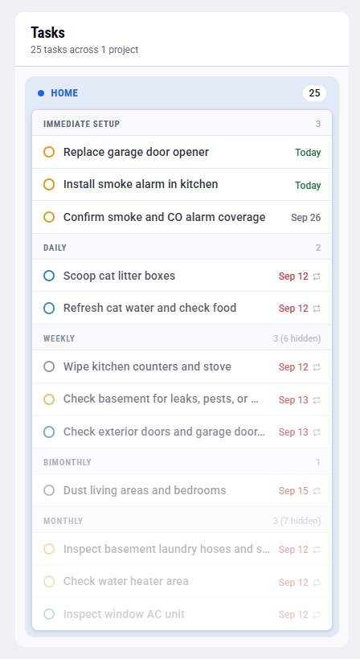
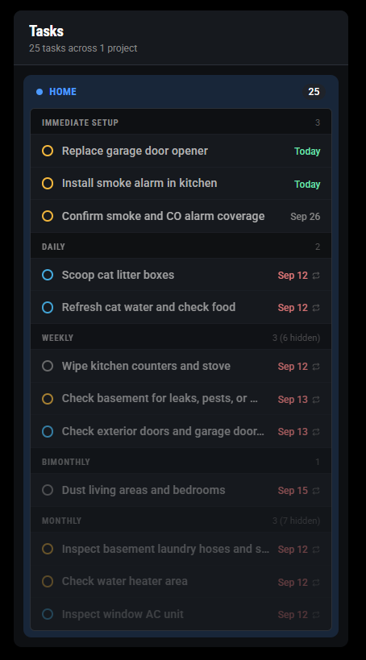
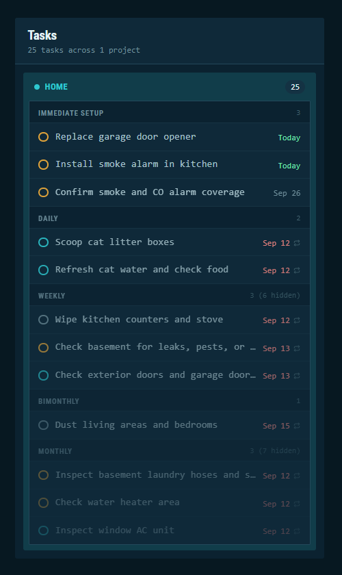
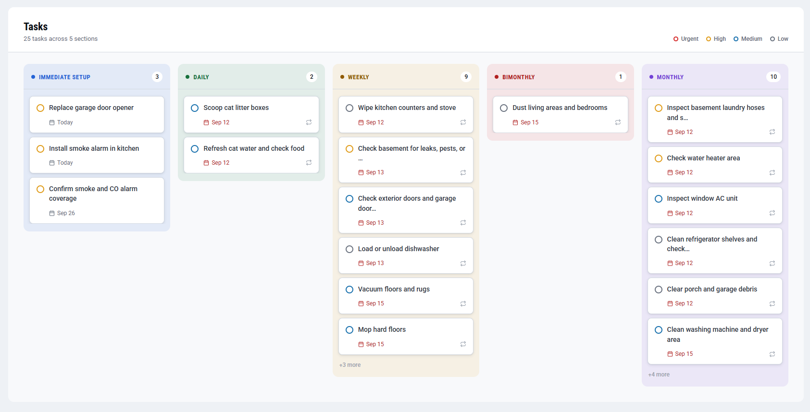
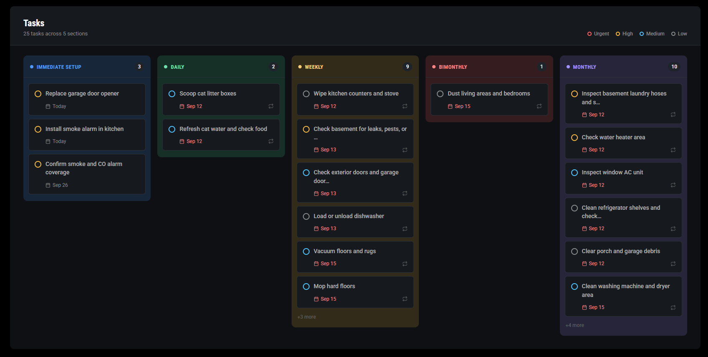
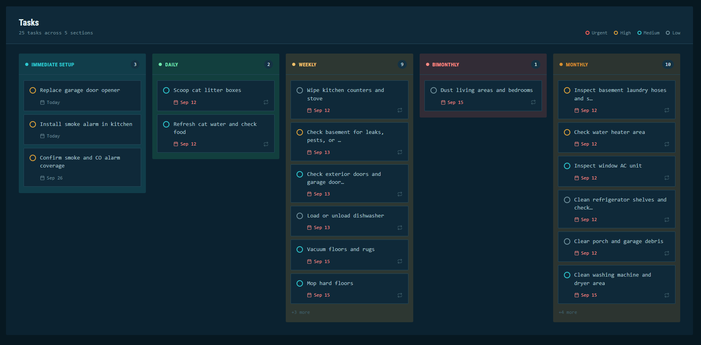
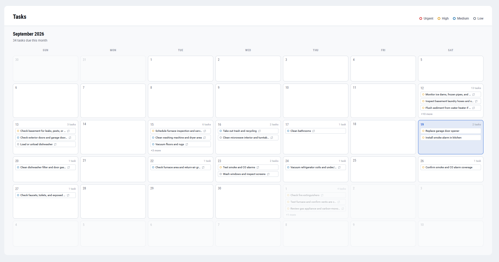
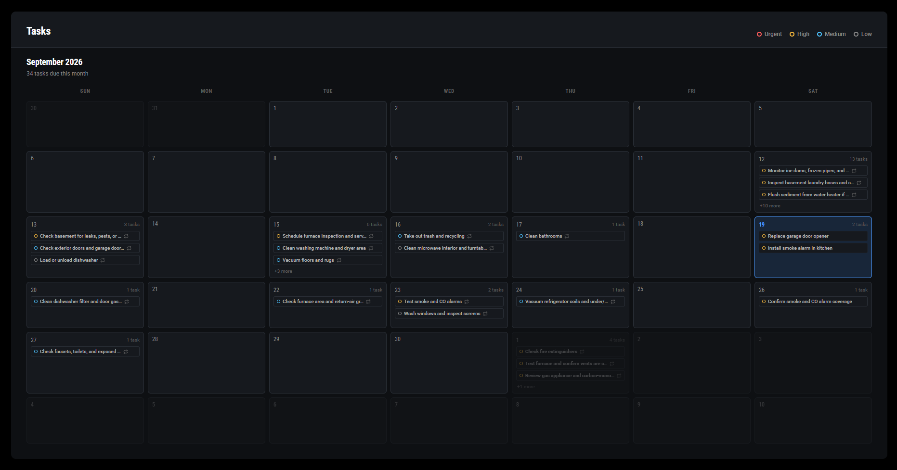
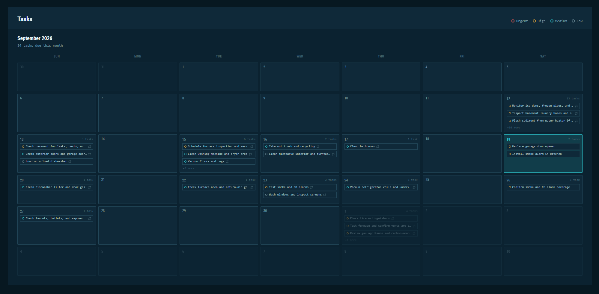

# MMM-Todoist2

A [MagicMirror](https://github.com/MichMich/MagicMirror) module to display your Todoist tasks with multiple display modes (list, kanban, calendar).

> **Note:** This is an updated version of [MMM-Todoist](https://github.com/cbrooker/MMM-Todoist), which is no longer maintained.

## TODOS
- Show completed tasks on calendar view (need to query an additional API endpoint to get completeds)
- Add `showTasksWithoutDueDate` to calendar settings, which should display a similar `list` display mode on the right of the calendar with ONLY the tasks missing a due date.
- Test webhooks for automatic UI updates
- Display user initials for assigned tasks in all display modes

---

## Getting Started

### Installation

1. Navigate to your MagicMirror's `modules` folder:
   ```bash
   cd ~/MagicMirror/modules
   ```

2. Clone this repository:
   ```bash
   git clone https://github.com/ZachR19/MMM-Todoist2.git
   cd MMM-Todoist2
   ```

3. Install dependencies:
   ```bash
   npm install
   ```

### Basic Configuration

Add the module to your `config/config.js`:

```javascript
modules: [
  {
    module: 'MMM-Todoist2',
    position: 'top_right',
    header: 'Todoist',
    config: {
      apiKey: '<apiKey>',
      projects: ['abc123'],            // or use labels: ['Work', 'Important']
      maximumEntries: 60,              // # of task to show max
      updateInterval: 10 * 60 * 1000,  // Update every 10 minutes
      displayMode: "calendar",         // list, calendar, or kanban
    }
  }
]
```

### Todoist Authentication 

The easiest way to autheticate with your personal Todoist account is to create an **API Token** - found in your Todoist account's [Integration > Developer settings](https://todoist.com/app/settings/integrations/developer)

### Get Your Project ID

1. Go to [Todoist](https://todoist.com) and log in
2. Click on a project in the left menu
3. Look at your browser URL - it will be something like: `https://app.todoist.com/app/project/myProject-6Xqv9F57VC6mR948`
4. The Project ID is everything after `myProject-`, in this case: `6Xqv9F57VC6mR948`

**Tip:** Enable `debug: true` in this modules config to see all Project IDs logged to the MagicMirror display and browser console.

### Key Features

- **Multiple Display Modes**: List (default), Kanban board, or Month calendar
- **Flexible Filtering**: Show tasks by project, labels, or both
- **Smart Sorting**: Sort by priority, due date, project, or Todoist order
- **Smart Updates**: Pauses when module is hidden; resumes immediately when shown
- **Theming**: Uses MagicMirror's built-in theme system
- **Multiple Instances**: Add different configs for different project views

---

## Migrating from MMM-Todoist
A lot has changed from the original module - it is recommended to start fresh and delete your old MMM-Todoist folder/config and follow the installation instructions below.


## Installation
1. Navigate into your MagicMirror's `modules` folder and execute `git clone https://github.com/ZachR19/MMM-Todoist2.git`. A new folder will appear - navigate into it.
2. Execute `npm install` to install the node dependencies.

## Using the module

To use this module, add it to the modules array in the `config/config.js` file:

> See [MMM-Todoist2.js](./MMM-Todoist2.js) for all of the available settings. This is just the quickstart config.

````javascript
modules: [
{
	module: 'MMM-Todoist2',
	position: 'top_right',	
	header: 'Todoist',                                  
	config: {
		apiKey: '<your_api_key>',
		hideWhenEmpty: false,
		maximumEntries: 60,
		updateInterval: 10*60*1000,                  
		fade: false,      
		groupByProject: false,
		projects: [ "abc123" ],
		labels: [ "MagicMirror", "Important" ],
		displayMode: "list"
}
]
````

## Configuration options

The following properties can be configured:


<table width="100%">
	<thead>
		<tr>
			<th>Option</th>
			<th width="100%">Description</th>
		</tr>
	<thead>
	<tbody>
		<tr>
			<td><code>apiKey</code></td>
			<td>Your Todoist API Key<br>
				<br><b>Data Type:</b> <code>string</code>
				<br><b>Default value:</b> <code>none</code>
			</td>
		</tr>
		<tr>
			<td><code>blacklistProjects</code></td>
			<td>
				When this option is enabled, <code>projects</code> becomes a <i>blacklist.</i>
				Any project that is <b>not</b> in <code>projects</code> will be used.<br>
				<br><b>Data Type:</b> <code>boolean</code>
				<br><b>Default value:</b> <code>false</code>
			</td>
		</tr>
		<tr>
			<td><code>projects</code></td>
			<td>
				Array of Project IDs you want to display. <br>
				<br><b>Data Type:</b> <code>array</code>
				<br><b>Default value:</b> <code>[ ]</code>
				<br><b>Example:</b> <code>["6Xqv9F57VC6mR948", "6XrQ2482qG7W9gh7"]</code>
			</td>
		</tr>
			<tr>
			<td><code>labels</code></td>
			<td>
				Array of label names you want to display. <br>
				<br><b>Data Type:</b> <code>array</code>
				<br><b>Default value:</b> <code>[ ]</code>
				<br><b>Example:</b> <code>["MagicMirror", "Important"]</code>
			</td>
		</tr>
		<tr>
			<td><code>maximumEntries</code></td>
			<td>Maximum number of tasks to be shown.<br>
				<br><b>Data Type:</b> <code>int</code>
				<br><b>Default value:</b> <code>25</code>
			</td>
		</tr>
		<tr>
			<td><code>updateInterval</code></td>
			<td>How often the module should load new todos. Be careful, this is in ms, NOT seconds! So, too low a number will lock you out for repeated API attempts!<br>
				<br><b>Data Type:</b> <code>int</code> in <code>milliseconds</code>
				<br><b>Default value:</b> <code>10*60*1000</code> (10 minutes)
			</td>
		</tr>
		<tr>
			<td><code>fade</code></td>
			<td>Fade todos to black - gradient effect<br>
				<br><b>Data Type:</b> <code>boolean</code>
				<br><b>Default value:</b> <code>true</code>
			</td>
		</tr>
		<tr>
			<td><code>fadePoint</code></td>
			<td>Where to start fade?<br>
				<br><b>Possible values:</b> <code>0</code> (top of the list) - <code>1</code> (bottom of list)
				<br><b>Default value:</b> <code>0.25</code>
			</td>
		</tr>
		<tr>
			<td><code>fadeMinimumOpacity</code></td>
			<td>Opacity of the last item if fade is enabled.<br>
				<br><b>Possible values:</b> <code>0</code> (last item is completely transparent) - <code>1</code> (no fade)
				<br><b>Default value:</b> <code>0.25</code>
			</td>
		</tr>
		<tr>
			<td><code>showProject</code></td>
			<td>If true this will display each task's project under its title. Hidden when <code>groupByProject</code> is on, since the group heading already names the project.<br>
				<br><b>Data Type:</b> <code>boolean</code>
				<br><b>Default value:</b> <code>true</code>
			</td>
		</tr>
		<tr>
			<td><code>sortOrder</code></td>
			<td>Array of properties to sort on, in the order they should be applied<br>
				<br><b>Possible values:</b> <br />
				<code>"todoist"</code> <span>- Sort based on the order in Todoist.</span></br >
				<code>"project"</code> <span>- Sort based on the project ID</span></br >
				<code>"priority"</code> <span>- Sort based on the priority, in Descending order. (Highest priority first)</span></br >
				<code>"dueDateAsc"</code> <span>- Sort based on the Due Date of the Todo Ascending. (Oldest date first)</span></br>
				<code>"dueDateDesc"</code> <span>- Sort based on the Due Date of the Todo Descending. (Newest date first)</span></br>
				<br><b>Default value:</b> <code>["todoist"]</code>
			</td>
		</tr>
		<tr>
			<td><code>displayLastUpdate</code></td>
			<td>If true this will display the last update time at the end of the task list. See screenshot below<br>
				<br><b>Data Type:</b> <code>boolean</code>
				<br><b>Default value:</b> <code>false</code>
			</td>
		</tr>
		<tr>
			<td><code>displayLastUpdateFormat</code></td>
			<td>Format to use for the time display if displayLastUpdate:true <br>
				<br><b>Possible values:</b> See <a href="http://momentjs.com/docs/#/parsing/string-format/">Moment.js formats</a>
				<br><b>Default value:</b> <code>'ddd - HH:mm:ss'</code>
			</td>
		</tr>
		<tr>
			<td><code>wrapEvents</code></td>
			<td>If true this will display the long tasks on several lines, according on the value <code>maxTitleLength</code>. See screenshot below. <br>
				<br><b>Data Type:</b> <code>boolean</code>
				<br><b>Default value:</b> <code>false</code>
			</td>
		</tr>
		<tr>
			<td><code>maxTitleLength</code></td>
			<td>Value cut the display of long tasks on several lines.<br>
				<br><b>Possible values:</b> <code>10</code> - <code>50</code>
				<br><b>Default value:</b> <code>25</code>
			</td>
		</tr>
		<tr>
			<td><code>displayTasksWithinDays</code></td>
			<td>If non-negative, only display tasks with a due date within <code>displayTasksWithinDays</code> days. For instance, setting this to 0 will only show tasks due today or overdue. This will not affect tasks without a due date, <code>displayTasksWithoutDue</code> controls those.<br>
				<br><b>Possible values:</b> <code>-1</code> - <code>∞</code>
				<br><b>Default value:</b> <code>-1</code> (filtering disabled)
			</td>
		</tr>
		<tr>
			<td><code>displayTasksWithoutDue</code></td>
			<td>Controls if tasks without a due date are displayed.<br>
				<br><b>Data Type:</b> <code>boolean</code>
				<br><b>Default value:</b> <code>true</code>
			</td>
		</tr>
		<tr>
			<td><code>displaySubtasks</code></td>
			<td>Controls if subtasks are displayed or not.<br>
				<br><b>Data Type:</b> <code>boolean</code>
				<br><b>Default value:</b> <code>true</code>
			</td>
		</tr>
		<tr>
			<td><code>hideWhenEmpty</code></td>
			<td>Hide module when all lists are empty.<br>
				<br><b>Data Type:</b> <code>boolean</code>
				<br><b>Default value:</b> <code>false</code>
			</td>
		</tr>
		<tr>
			<td><code>groupByProject</code></td>
			<td>List display only. Groups tasks under a heading per project, in the order the projects appear in Todoist. Tasks keep <code>sortOrder</code> within each group. Combine with <code>groupBySection</code> to split each project by section.<br>
				<br><b>Data Type:</b> <code>boolean</code>
				<br><b>Default value:</b> <code>false</code>
			</td>
		</tr>
		<tr>
			<td><code>groupBySection</code></td>
			<td>List display only. Groups tasks under a heading per Todoist section, in the order the sections appear in Todoist. Sections with the same name in different projects share one group, and tasks outside any section are gathered in a final group (see <code>unsectionedListGroupLabel</code>).<br>
				<br>With <code>groupByProject</code> also on, sections become subheadings inside each project, and tasks outside any section are listed first, as in Todoist.
				<br><b>Data Type:</b> <code>boolean</code>
				<br><b>Default value:</b> <code>false</code>
			</td>
		</tr>
		<tr>
			<td><code>unsectionedListGroupLabel</code></td>
			<td>List display only. Heading for tasks that are not in a section, when grouping by section alone.<br>
				<br><b>Data Type:</b> <code>string</code>
				<br><b>Default value:</b> <code>"Other"</code>
			</td>
		</tr>
		<tr>
			<td><code>showListHeader</code></td>
			<td>List display only. Show the list's title bar with the task count, styled like the kanban and calendar displays. When <code>false</code>, MagicMirror's own module header is shown instead.<br>
				<br><b>Data Type:</b> <code>boolean</code>
				<br><b>Default value:</b> <code>true</code>
			</td>
		</tr>
		<tr>
			<td><code>showListLegend</code></td>
			<td>List display only. Show the priority legend in the list's title bar.<br>
				<br><b>Data Type:</b> <code>boolean</code>
				<br><b>Default value:</b> <code>false</code>
			</td>
		</tr>
		<tr>
			<td><code>listTitle</code></td>
			<td>List display only. The title shown in the list's title bar. Defaults to the module's <code>header</code>, or <code>"My Tasks"</code>.<br>
				<br><b>Data Type:</b> <code>string</code>
				<br><b>Default value:</b> <code>null</code>
			</td>
		</tr>
	</tbody>
</table>

## Kanban display

Set `displayMode: "kanban"` to render the tasks as a read-only kanban taskboard
instead of the default list. One column is created per Todoist **section**. The module's `filter`,
`sortOrder`, `maximumEntries` and the `displayTasksWithin*` options all still
apply.

```js
{
    module: "MMM-Todoist2",
    position: "fullscreen_below",
    header: "MY TASKS",
    config: {
        apiKey: "...",
        displayMode: "kanban",
        maximumEntries: 60,
        maximumEntriesPerKanbanColumn: 8,
        kanbanColumnOrder: ["Daily", "Weekly", "Bimonthly", "Monthly", "Quarterly"],
        sortOrder: ["priority", "dueDateAsc"]
    }
}
```

The board needs room for its columns, so give it a wide region such as
`fullscreen_below`, `top_bar` or `lower_third`. Columns share the available
width rather than scrolling, since nothing off-screen is reachable on a mirror.

---

### Kanban configuration options

<table width="100%">
	<thead>
		<tr>
			<th>Option</th>
			<th width="100%">Description</th>
		</tr>
	<thead>
	<tbody>
		<tr>
			<td><code>maximumEntriesPerKanbanColumn</code></td>
			<td>How many task cards each column displays. Tasks beyond this are summarised as a <code>+N more</code> line at the bottom of the column, and the column's count badge still shows the full total. Set to <code>0</code> for no per-column limit.<br>
				<br><b>Note:</b> <code>maximumEntries</code> still caps the total number of tasks across the whole board, so raise it when using the kanban display.
				<br><b>Data Type:</b> <code>integer</code>
				<br><b>Default value:</b> <code>8</code>
			</td>
		</tr>
		<tr>
			<td><code>kanbanColumnOrder</code></td>
			<td>Section names, in the order their columns should appear. Sections not listed here follow, in the order Todoist reports them. Matching is case-insensitive.<br>
				<br><b>Data Type:</b> <code>array of strings</code>
				<br><b>Default value:</b> <code>[]</code>
			</td>
		</tr>
		<tr>
			<td><code>mergeKanbanColumnsByName</code></td>
			<td>Whether sections that share a name across different projects share a single column. Set to <code>false</code> to give every section its own column.<br>
				<br><b>Data Type:</b> <code>boolean</code>
				<br><b>Default value:</b> <code>true</code>
			</td>
		</tr>
		<tr>
			<td><code>hideEmptyKanbanColumns</code></td>
			<td>Hide columns that have no tasks to show. Set to <code>false</code> to keep a fixed set of columns on screen, which is most useful together with <code>kanbanColumnOrder</code>.<br>
				<br><b>Data Type:</b> <code>boolean</code>
				<br><b>Default value:</b> <code>true</code>
			</td>
		</tr>
		<tr>
			<td><code>showUnsectionedKanbanColumn</code></td>
			<td>Whether tasks that are not in any Todoist section get their own column, shown last. Set to <code>false</code> to leave them off the board entirely.<br>
				<br><b>Data Type:</b> <code>boolean</code>
				<br><b>Default value:</b> <code>true</code>
			</td>
		</tr>
		<tr>
			<td><code>unsectionedKanbanColumnLabel</code></td>
			<td>The heading used for that column.<br>
				<br><b>Data Type:</b> <code>string</code>
				<br><b>Default value:</b> <code>"Other"</code>
			</td>
		</tr>
		<tr>
			<td><code>showKanbanHeader</code></td>
			<td>Show the board's own header bar, with the title and a task count. Set to <code>false</code> if you already set the module's <code>header</code> and do not want it twice.<br>
				<br><b>Data Type:</b> <code>boolean</code>
				<br><b>Default value:</b> <code>true</code>
			</td>
		</tr>
		<tr>
			<td><code>showKanbanLegend</code></td>
			<td>Show the priority legend on the right of the board header.<br>
				<br><b>Data Type:</b> <code>boolean</code>
				<br><b>Default value:</b> <code>true</code>
			</td>
		</tr>
		<tr>
			<td><code>kanbanTitle</code></td>
			<td>The board title. When left unset, the module's <code>header</code> is used, falling back to "My Tasks".<br>
				<br><b>Data Type:</b> <code>string</code>
				<br><b>Default value:</b> <code>null</code>
			</td>
		</tr>
		<tr>
			<td><code>highlightOverdueKanbanTasks</code></td>
			<td>Colour the due date of overdue tasks with the urgent priority colour, instead of the muted colour used for every other date.<br>
				<br><b>Data Type:</b> <code>boolean</code>
				<br><b>Default value:</b> <code>true</code>
			</td>
		</tr>
	</tbody>
</table>

--- 

## Calendar display

Set `displayMode: "calendar"` to render the tasks as a read-only month
calendar instead of the default list. Each task appears as a chip on the day it
is due, and the same `filter`, `sortOrder`, `maximumEntries` and
`displayTasksWithin*` options still apply.

Tasks with no due date cannot be placed on a calendar, so they are left out of
this display regardless of `displayTasksWithoutDue`.

```js
{
    module: "MMM-Todoist2",
    position: "fullscreen_below",
    header: "MY TASKS",
    config: {
        apiKey: "...",
        displayMode: "calendar",
        maximumEntries: 200,
        maximumEntriesPerCalendarDay: 3,
        calendarWeekStartsOn: 1,
        displayTasksWithinDays: -1,
        displayTasksWithoutDue: false
    }
}
```

A month grid needs the full width of the mirror, so give it a wide region such
as `fullscreen_below` or `lower_third`. Note that `maximumEntries` caps the
tasks fetched for the whole month, and `displayTasksWithinDays` will empty most
of the grid if you leave it at a small number, so widen both for this display.

### Calendar configuration options

<table width="100%">
	<thead>
		<tr>
			<th>Option</th>
			<th width="100%">Description</th>
		</tr>
	<thead>
	<tbody>
		<tr>
			<td><code>maximumEntriesPerCalendarDay</code></td>
			<td>How many task chips each day shows. Tasks beyond this are summarised as a <code>+N more</code> line, and the day's count still shows the full total. Set to <code>0</code> for no limit, though tall cells will push the grid off screen.<br>
				<br><b>Data Type:</b> <code>integer</code>
				<br><b>Default value:</b> <code>3</code>
			</td>
		</tr>
		<tr>
			<td><code>calendarMonthOffset</code></td>
			<td>How many months from the current one to display. The calendar is read-only and has no navigation, so this is how you pin it to a different month. <code>1</code> shows next month, <code>-1</code> last month.<br>
				<br><b>Data Type:</b> <code>integer</code>
				<br><b>Default value:</b> <code>0</code>
			</td>
		</tr>
		<tr>
			<td><code>calendarWeekStartsOn</code></td>
			<td>Which day the grid's first column is. <code>0</code> is Sunday, <code>1</code> is Monday.<br>
				<br><b>Possible values:</b> <code>0</code> to <code>6</code>
				<br><b>Default value:</b> <code>0</code>
			</td>
		</tr>
		<tr>
			<td><code>calendarAlwaysSixWeeks</code></td>
			<td>Always draw six rows, so the module keeps the same height from month to month. Set to <code>false</code> to draw only the weeks the month actually needs, which saves space.<br>
				<br><b>Data Type:</b> <code>boolean</code>
				<br><b>Default value:</b> <code>true</code>
			</td>
		</tr>
		<tr>
			<td><code>highlightTodayInCalendar</code></td>
			<td>Outline today's cell and pick out its date.<br>
				<br><b>Data Type:</b> <code>boolean</code>
				<br><b>Default value:</b> <code>true</code>
			</td>
		</tr>
		<tr>
			<td><code>showCalendarDayTaskCounts</code></td>
			<td>Show "N tasks" next to the day number on days that have any.<br>
				<br><b>Data Type:</b> <code>boolean</code>
				<br><b>Default value:</b> <code>true</code>
			</td>
		</tr>
		<tr>
			<td><code>showCalendarHeader</code></td>
			<td>Show the title bar above the month. Set to <code>false</code> if you already set the module's <code>header</code> and do not want it twice; the month name and its task count are shown either way.<br>
				<br><b>Data Type:</b> <code>boolean</code>
				<br><b>Default value:</b> <code>true</code>
			</td>
		</tr>
		<tr>
			<td><code>showCalendarLegend</code></td>
			<td>Show the priority legend in that title bar.<br>
				<br><b>Data Type:</b> <code>boolean</code>
				<br><b>Default value:</b> <code>true</code>
			</td>
		</tr>
		<tr>
			<td><code>calendarTitle</code></td>
			<td>The title shown in that bar. When left unset, the module's <code>header</code> is used, falling back to "My Tasks".<br>
				<br><b>Data Type:</b> <code>string</code>
				<br><b>Default value:</b> <code>null</code>
			</td>
		</tr>
	</tbody>
</table>

## Theming

This module was designed to be used alongside my [MMM-Themes](https://github.com/ZachR19/MMM-Themes) module. 

The themes allow you to easily swap out the CSS styling for all modules by only changing one line of code.


# Screen shots
A few sample screenshots to show what this module looks like. It's fairly configurable and changes considerably depending on how you use Todoist, how many projects you include, and how you sort.  

## List View
#### Light Theme


#### Dark Theme


#### Space Theme



## Kanban View
#### Light Theme


#### Dark Theme


#### Space Theme



## Calendar View
#### Light Theme


#### Dark Theme


#### Space Theme



## Attribution

MMM-Todoist2 is based on [MMM-Todoist](https://github.com/cbrooker/MMM-Todoist) by Chris Brooker.
MMM-Todoist was based on [MMM-Wunderlist](https://github.com/paviro/MMM-Wunderlist) by Paul-Vincent. 